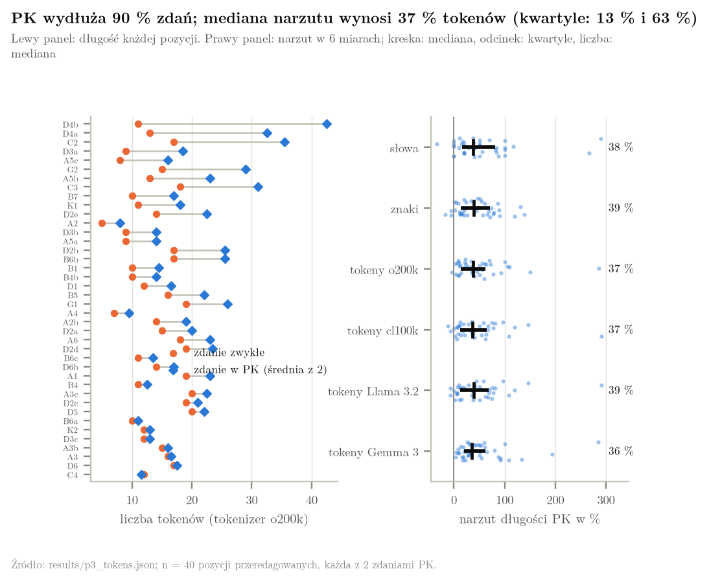
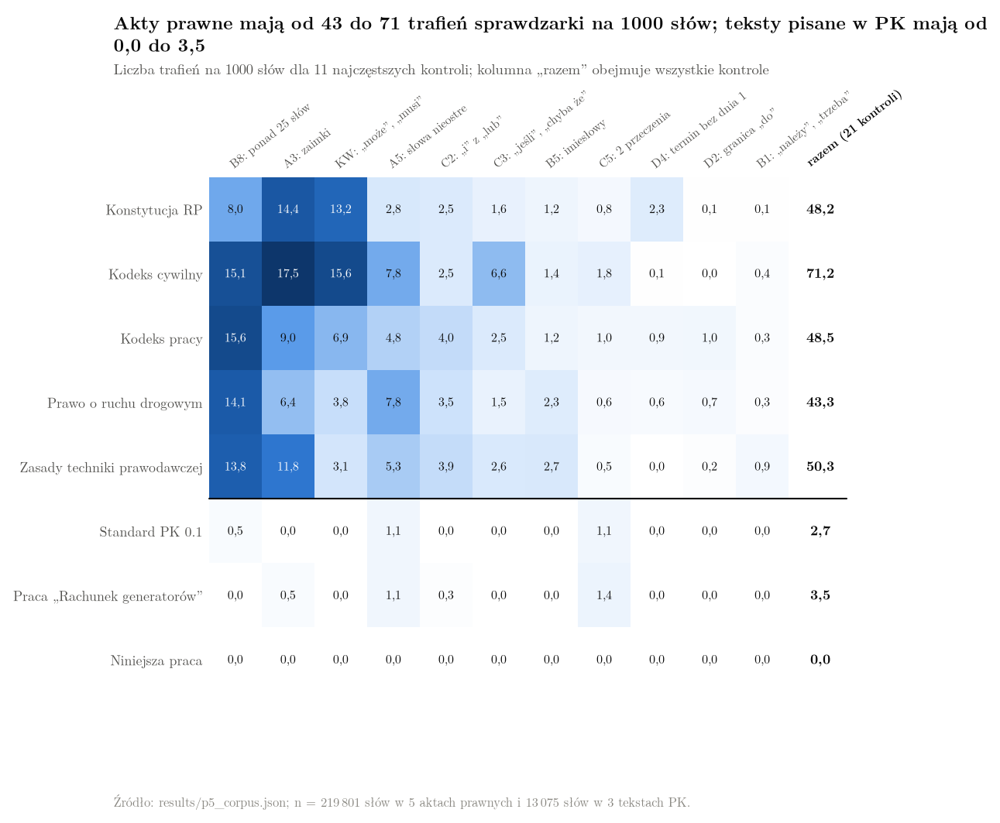
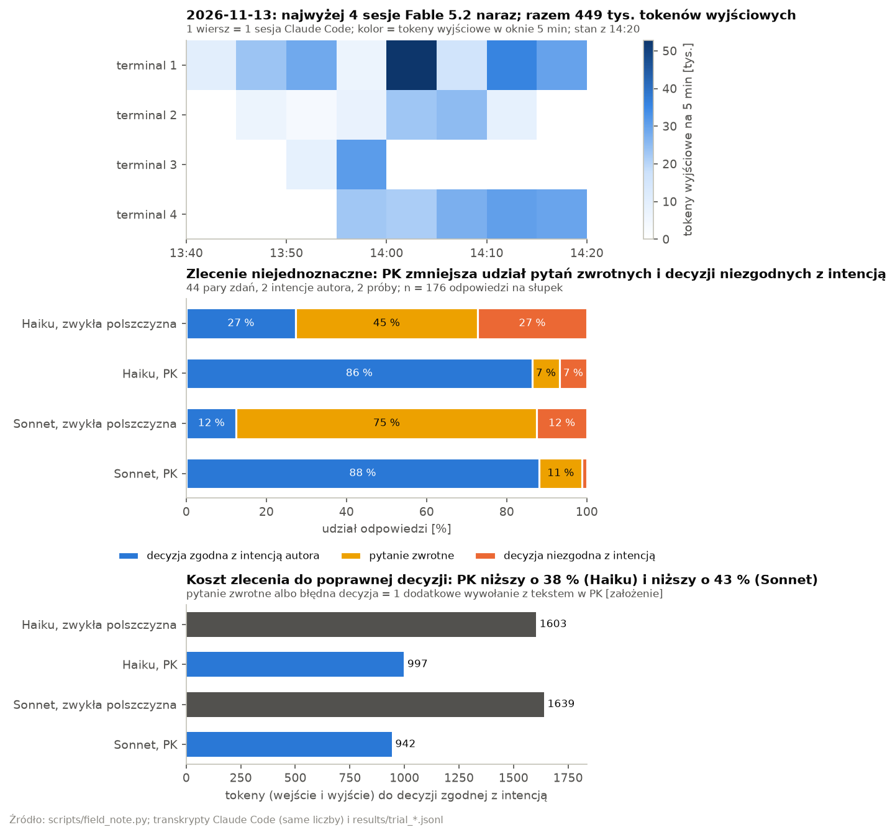

# Polszczyzna Kontrolowana (PK)

PK to zwykły polski plus zbiór reguł dla tekstów, według których ktoś działa. Każda reguła usuwa jedno źródło zdań, które mają więcej niż
jedno znaczenie. Czytelnik, który zna konwencję, odczytuje każde zdanie w jeden sposób.

Wersja 0.1. Autor: Maciej Szulia. Pełny standard: [`SKILL.md`](skills/polszczyzna-kontrolowana/SKILL.md).

## Po co

Polska gramatyka zostawia czytelnikowi wybór w stałych miejscach: brak rodzajników,
swobodny szyk, dopełniacz, spójniki, granice przedziałów. PK zamyka każde z tych miejsc
konwencją.

| Zdanie w zwykłym polskim | Znaczenia | Zdanie w PK |
|---|---|---|
| „Dzieci do 3 lat wchodzą bezpłatnie.” | mniej niż 3 lata; mniej niż 4 lata | „Dziecko, które ma mniej niż 4 lata, wchodzi bezpłatnie.” |
| „Zawór zamyka się po pracy.” | ktoś zamyka zawór; zawór zamyka się sam; czytelnik ma zamknąć zawór | „Operator zamyka zawór Z1 po zakończeniu pracy.” |
| „Wyślij raport do piątku.” | termin obejmuje piątek; termin kończy się przed piątkiem | „Wyślij raport najpóźniej 2026-11-13 o godz. 16:00.” |
| „Wszystkie zawory nie są zamknięte.” | żaden nie jest zamknięty; nie każdy jest zamknięty | „Żaden zawór nie jest zamknięty.” albo „Co najmniej 1 zawór jest otwarty.” |

## Co zawiera standard

- **Słowa kluczowe wymagań:** MUSI, NIE WOLNO, POWINIEN, NIE POWINIEN, MOŻE. Wzorem jest RFC 2119.
- **32 numerowane reguły w 5 grupach:** A. Słowa, B. Zdanie, C. Logika, D. Liczby, wielkości, czas,
  E. Struktura tekstu. Do tego moduł F dla raportów: znacznik źródła przy każdym fakcie.
- **Słowa zakazane** z powodem i zamiennikiem, na przykład „niezwłocznie”, „regularnie”, „do”, „i/lub”.
- **Kontrola:** 7 kroków po napisaniu tekstu, w tym liczenie słów i test 2 znaczeń.
- **Zasada braków:** brakującej liczby, daty lub wykonawcy nie wolno zgadywać. W tekście
  zostaje znacznik `[DO USTALENIA: czego brakuje]`.

## Do czego służy

Instrukcja, procedura, regulamin, wymaganie, specyfikacja, umowa, raport techniczny.
PK nie służy do literatury, reklamy i rozmowy. PK to inny standard niż prosty język
(ISO 24495-1): prosty język służy łatwemu zrozumieniu, PK służy jednemu znaczeniu.
Umowa w PK nadal wymaga oceny prawnika.

## Użycie jako skill Claude

```sh
git clone https://github.com/maciejszulia/polszczyzna-kontrolowana.git
ln -s "$PWD/polszczyzna-kontrolowana/skills/polszczyzna-kontrolowana" ~/.claude/skills/
```

Claude Code wczyta skill w następnej sesji. Skill ma 3 tryby:

| Tryb | Prośba | Wynik |
|---|---|---|
| PISZ | „napisz instrukcję w PK” | nowy tekst w PK oraz tabela „Decyzje i braki” |
| PRZEREDAGUJ | „usuń niejednoznaczności” | tekst w PK oraz tabela „Decyzje i braki” |
| SPRAWDŹ | „sprawdź w PK” | tabela naruszeń, tekst źródłowy bez zmian |

## Przykłady

- [Terminy utworzone w projekcie gospodarstwa samowystarczalnego](przyklady/terminy-utworzone-gospodarstwo.md):
  8 terminów utworzonych, 34 nazwy obiektów i 4 poprawione błędy z projektu, który stosuje PK 0.1.

## Praca badawcza

Katalog `paper/` zawiera pracę „Polszczyzna kontrolowana jako metoda redukcji złożoności
obliczeniowej w AI. Ujęcie logiczno-mnogościowe oraz refleksja filozoficzna w świetle
hipotezy Sapira-Whorfa” i sprawozdanie z pomiarów.

| Plik | Zawartość |
|---|---|
| [`paper/pk_complexity_pl.pdf`](paper/pk_complexity_pl.pdf) | praca: model, twierdzenia, 5 pomiarów, 12 rysunków |
| [`paper/measurement_report_pl.pdf`](paper/measurement_report_pl.pdf) | sprawozdanie z pomiarów: warunki, wyniki, problemy |
| `data/items.csv` | 44 pozycje testowe: zdanie zwykłe, 2 odczytania, 2 zdania PK, 3 sondy |
| `data/rules.csv` | klasyfikacja 32 reguł, modułu F i słów kluczowych |
| `src/pkmodel.py` | model: odczytania, parser z licznikiem operacji, klauzule Horna, redukcja z 3-SAT |
| `src/pklint.py` | sprawdzarka reguł mechanicznych PK |
| `scripts/measure.py`, `scripts/probe.py`, `scripts/figures.py` | pomiary, sonda na modelach językowych, rysunki |
| `results/` | wyniki pomiarów i surowe odpowiedzi modeli |

Praca pokazuje 3 rzeczy. PK zostawia zdaniu 1 odczytanie. PK wydłuża tekst.
Spójność zbioru wymagań bez przeczeń jest rozstrzygalna w czasie liniowym, a 1 przeczenie
w zdaniu wystarcza do NP-zupełności.





Odtworzenie wyników:

```sh
python -m venv .venv && .venv/bin/pip install -r requirements.txt
make PY=.venv/bin/python MEASURE_FLAGS=--offline all
```

Polecenie bez flagi `--offline` pobiera tokenizery i akty prawne z sieci. Sprawdzarka
działa także osobno: `python -m src.pklint PLIK` dla tekstu oraz
`python -m src.pklint --tex PLIK` dla pliku LaTeX.

<!-- field-note:start -->
## Notatka z pracy: 4 sesje równolegle (2026-11-13)

Autor prowadził 2026-11-13 równolegle 4 sesje Claude Code z modelem Fable 5.2.
Standard PK był wczytany w 4 z 4 sesji. Agenci pisali w PK plany, raporty
i zlecenia dla innych agentów. Autor ocenia, że PK ułatwia prowadzenie 4 sesji naraz,
bo tekst agenta ma 1 odczytanie `[relacja: autor, 2026-11-13]`.

| Wielkość | Wartość |
|---|---|
| sesje z modelem Fable 5.2 | 4 |
| najwięcej sesji aktywnych w 1 oknie 5 min | 4 |
| wywołania modelu | 138 |
| tokeny wyjściowe | 449 tys. |
| tokeny zapisu do cache'u | 1,68 mln |
| tokeny odczytu z cache'u | 48,3 mln |
| zlecenia autora | 6 |
| mediana tokenów wyjściowych na 1 zlecenie | 49 tys. |

Źródło tabeli: `[pomiar: transkrypty Claude Code, 2026-11-13 14:20]`.

### Czy PK oszczędza tokeny

Wynik pomiaru: przy zleceniu niejednoznacznym PK oszczędza tokeny. Przy zleceniu o 1 odczytaniu
PK kosztuje tokeny.

Pomiar używa 44 par zdań z pracy badawczej (`data/items.csv`). Zdanie zwykłe ma 2 odczytania.
Zdanie PK ma 1 odczytanie. Model dostaje tekst i sytuację, w której 2 odczytania dają różne
decyzje. Model odpowiada „Tak” albo „Nie”, albo zadaje pytanie zwrotne. Autor zdania zwykłego
ma na myśli każde z 2 odczytań w połowie przypadków `[założenie]`.

| Model | Tekst | Decyzja zgodna z intencją | Pytanie zwrotne | Decyzja niezgodna | Tokeny do poprawnej decyzji |
|---|---|---|---|---|---|
| Haiku | zwykła polszczyzna | 27 % | 45 % | 27 % | 1603 |
| Haiku | PK | 86 % | 7 % | 7 % | 997 |
| Sonnet | zwykła polszczyzna | 12 % | 75 % | 12 % | 1639 |
| Sonnet | PK | 88 % | 11 % | 1 % | 942 |

Źródło tabeli: `[pomiar: scripts/token_trial.py, 2026-11-13 14:20]`; 176 odpowiedzi na wiersz.

- Koszt tokenów do poprawnej decyzji jest w PK niższy o 38 % (Haiku) i o 43 % (Sonnet) `[obliczenie: tabela]`.
  Pytanie zwrotne albo decyzja niezgodna kosztuje 1 dodatkowe wywołanie z tekstem w PK `[założenie]`.
- Zdania testowe są wybrane jako niejednoznaczne. Dla zdania o 1 odczytaniu PK jest tylko
  kosztem: mediana narzutu wynosi 37 % tokenów `[źródło: paper/pk_complexity_pl.pdf, pomiar P3]`.
- Standard PK ma w kontekście sesji długość 8283 tokenów `[obliczenie: tokenizer o200k_base]`.
  W 4 sesjach dało to 0,99 mln tokenów odczytu z cache'u. Ta liczba odpowiada
  20 tys. tokenów wyjściowych według wag cennika: wyjście 5, odczyt 0,1 `[obliczenie]`.
- 1 zlecenie wykonane błędnie i powtórzone kosztuje medianę 49 tys. tokenów wyjściowych.
  PK zwraca się, gdy zapobiega co najmniej 1 powtórce na dzień `[obliczenie]`.
- Liczby powtórek, którym PK zapobiegło 2026-11-13, nikt nie zmierzył. Zlecenia autora z tego dnia
  mają 21 trafień sprawdzarki PK na 1000 słów, czyli nie są pisane w PK
  `[pomiar: src/pklint.py, 2026-11-13 14:20]`.



Odtworzenie pomiaru i rysunku:

```sh
python scripts/token_trial.py haiku && python scripts/token_trial.py sonnet
python scripts/field_note.py --day 2026-11-13
```

<!-- field-note:end -->

## Źródła

Reguły opierają się między innymi na RFC 2119, ASD-STE100 Simplified Technical English,
„Zasadach techniki prawodawczej”, notacji EARS i ISO 8601. Pełna lista ze wskazaniem
reguł jest w sekcji „Źródła” pliku `SKILL.md`.

---

**EN:** Polszczyzna Kontrolowana (PK, "Controlled Polish") is ordinary Polish plus a numbered
rule set for text people act on. The rules leave every sentence exactly one meaning. It closes the places where Polish grammar leaves the
reader a choice (no articles, free word order, the genitive, conjunctions, range
boundaries). It ships as a Claude skill that writes, rewrites and audits Polish text;
its English counterpart is ASD-STE100.
